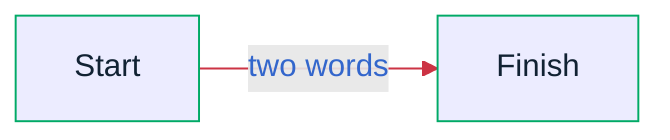

# Mermaid ASCII

Render mermaid diagrams in your terminal.

Extended output supports display-cell-aware Unicode labels, nested subgraphs,
separate routes for repeated edges, and opt-in compact boxes and uniform gaps.
Recent repairs preserve arrowheads, border attachments, junctions, and spaces in
edge labels. ASCII output retains its existing behavior.

See the [changelog](CHANGELOG.md) for unreleased changes and the
[renderer audit](automation/render-audit.md) for tested cases and limitations.

## Quick start

Clone the repository and use the Go toolchain (or the provided `Makefile`) to build the CLI:

```bash
git clone https://github.com/AlexanderGrooff/mermaid-ascii.git
cd mermaid-ascii
# build the binary
go build
# or, using the Makefile
make mermaid-ascii

# run the renderer
./mermaid-ascii --help
```

Run Go unit tests with `go test ./...` and demo control tests with
`node --test automation/site.test.cjs`. `make test` runs both (Node 18+ required).

## Installation

You can download the binary from Github releases:

```bash
# Get the latest release
$ curl -s https://api.github.com/repos/AlexanderGrooff/mermaid-ascii/releases/latest | grep "browser_download_url.*mermaid-ascii" | grep "$(uname)_$(uname -m)" | cut -d: -f2,3 | tr -d \" | wget -qi -
# Unzip it
$ tar xvzf mermaid-ascii_*.tar.gz
$ ./mermaid-ascii --help
```

You can also build it yourself:

```bash
$ git clone
$ cd mermaid-ascii
$ go build
$ mermaid-ascii --help
```

Or using Nix:
```bash
$ git clone
$ cd mermaid-ascii
$ nix build
$ ./result/bin/mermaid-ascii --help
```

## Usage

You can render graphs directly from the command line or start a web interface to render them interactively.

Box padding is independent of spacing between nodes. Extended output defaults to
one cell of box padding on each axis. Opt into compact boxes with no blank rows:

```bash
printf 'graph LR\nA-->B\n' | ./mermaid-ascii --boxPaddingX 1 --boxPaddingY 0
```

`--boxPaddingX` and `--boxPaddingY` accept nonnegative cell counts and affect only
extended output. When omitted, they use the existing `--borderPadding` (`-p`)
value. `--paddingX`/`--paddingY` (`-x`/`-y`) still control gaps between nodes.
The Go API exposes nullable `lib.Options.BoxPaddingX` and `BoxPaddingY` fields;
nil preserves the existing defaults. Routing and shared grid bands may enlarge
boxes beyond these minimum paddings.

Use `--uniformSpacing` to keep gaps between node bands equal on each axis.
The renderer expands them to the largest gap needed by labels, arrowheads, or
group clearance; it never squeezes a label to fit. This is opt-in, applies only
to extended output, and is exposed as `lib.Options.UniformSpacing`. It equalizes
border-to-border gaps, not box sizes or distances between node centers.

For compact boxes with evenly spaced blocks and a multiword arrow label:

```bash
./mermaid-ascii --boxPaddingX 1 --boxPaddingY 0 --uniformSpacing <<'MERMAID'
graph LR
A-->|a long edge label|B
B-->C
MERMAID
```

```text
┌───┐                   ┌───┐                   ┌───┐
│ A ├─a long edge label►│ B ├──────────────────►│ C │
└───┘                   └───┘                   └───┘
```

In the demo, enable extended characters and set **Box padding Y** to `0`.
**Uniform gaps** enables equal spacing. Shared URLs retain both settings.
The WASM options use `boxPaddingX`, `boxPaddingY`, and `uniformSpacing` JSON keys.
After `make wasm`, run `node automation/wasm-smoke.cjs` to check the built renderer
through the worker message handler.

Build with `make wasm`, then serve with `make serve` and open
`http://localhost:5173` (TinyGo and Python 3 required). `make serve` rebuilds and
copies the site files and TinyGo runtime into `dist/`. Node 18+ is required for
the smoke test; browser interaction still needs a separate manual check.

```bash
$ cat test.mermaid
graph LR
A --> B & C
B --> C & D
D --> C
$ mermaid-ascii --file test.mermaid
┌───┐     ┌───┐     ┌───┐
│   │     │   │     │   │
│ A ├────►│ B ├────►│ D │
│   │     │   │     │   │
└─┬─┘     └─┬─┘     └─┬─┘
  │         │         │  
  │         │         │  
  │         │         │  
  │         │         │  
  │         ▼         │  
  │       ┌───┐       │  
  │       │   │       │  
  └──────►│ C │◄──────┘  
          │   │          
          └───┘          

# Increase horizontal spacing
$ mermaid-ascii --file test.mermaid -x 8
┌───┐        ┌───┐        ┌───┐
│   │        │   │        │   │
│ A ├───────►│ B ├───────►│ D │
│   │        │   │        │   │
└─┬─┘        └─┬─┘        └─┬─┘
  │            │            │  
  │            │            │  
  │            │            │  
  │            │            │  
  │            ▼            │  
  │          ┌───┐          │  
  │          │   │          │  
  └─────────►│ C │◄─────────┘  
             │   │             
             └───┘             

# Increase box padding
$ mermaid-ascii -f ./test.mermaid -p 3
┌───────┐     ┌───────┐     ┌───────┐
│       │     │       │     │       │
│       │     │       │     │       │
│       │     │       │     │       │
│   A   ├────►│   B   ├────►│   D   │
│       │     │       │     │       │
│       │     │       │     │       │
│       │     │       │     │       │
└───┬───┘     └───┬───┘     └───┬───┘
    │             │             │
    │             │             │
    │             │             │
    │             │             │
    │             ▼             │
    │         ┌───────┐         │
    │         │       │         │
    │         │       │         │
    │         │       │         │
    └────────►│   C   │◄────────┘
              │       │
              │       │
              │       │
              └───────┘

# Labeled edges
$ cat test.mermaid
graph LR
A --> B
A --> C
B --> C
B -->|example| D
D --> C
$ mermaid-ascii -f ./test.mermaid
┌───┐     ┌───┐         ┌───┐
│   │     │   │         │   │
│ A ├────►│ B ├─example►│ D │
│   │     │   │         │   │
└─┬─┘     └─┬─┘         └─┬─┘
  │         │             │  
  │         │             │  
  │         │             │  
  │         │             │  
  │         ▼             │  
  │       ┌───┐           │  
  │       │   │           │  
  └──────►│ C │◄──────────┘  
          │   │              
          └───┘              

# Top-down layout
$ cat test.mermaid
graph TD
A --> B
A --> C
B --> C
B -->|example| D
D --> C
$ mermaid-ascii -f ./test.mermaid
┌─────────┐          
│         │          
│    A    ├───────┐  
│         │       │  
└────┬────┘       │  
     │            │  
     │            │  
     │            │  
     │            │  
     ▼            ▼  
┌─────────┐     ┌───┐
│         │     │   │
│    B    ├────►│ C │
│         │     │   │
└────┬────┘     └───┘
     │            ▲  
     │            │  
  example         │  
     │            │  
     ▼            │  
┌─────────┐       │  
│         │       │  
│    D    ├───────┘  
│         │          
└─────────┘          

# Read from stdin
$ cat test.mermaid | mermaid-ascii
┌───┐     ┌───┐     ┌───┐
│   │     │   │     │   │
│ A ├────►│ B ├────►│ D │
│   │     │   │     │   │
└─┬─┘     └─┬─┘     └─┬─┘
  │         │         │  
  │         │         │  
  │         │         │  
  │         │         │  
  │         ▼         │  
  │       ┌───┐       │  
  │       │   │       │  
  └──────►│ C │◄──────┘  
          │   │          
          └───┘          

# Only ASCII
$ cat test.mermaid | mermaid-ascii --ascii
+---+     +---+     +---+
|   |     |   |     |   |
| A |---->| B |---->| D |
|   |     |   |     |   |
+---+     +---+     +---+
  |         |         |
  |         |         |
  |         |         |
  |         |         |
  |         v         |
  |       +---+       |
  |       |   |       |
  ------->| C |<-------
          |   |
          +---+

$ mermaid-ascii --help
Generate ASCII diagrams from mermaid code.

Usage:
  mermaid-ascii [flags]
  mermaid-ascii [command]

Available Commands:
  completion  Generate the autocompletion script for the specified shell
  help        Help about any command
  web         HTTP server for rendering mermaid diagrams.

Flags:
  -a, --ascii               Don't use extended character set
  -p, --borderPadding int   Padding between text and border (default 1)
      --boxPaddingX int     Horizontal box padding (extended characters only) (default 1)
      --boxPaddingY int     Vertical box padding (extended characters only; 0 for compact boxes) (default 1)
      --color string        Color output: auto, always, never (extended characters only) (default "auto")
  -c, --coords              Show coordinates
  -f, --file string         Mermaid file to parse (use '-' for stdin)
  -h, --help                help for mermaid-ascii
  -x, --paddingX int        Horizontal space between nodes (default 5)
  -y, --paddingY int        Vertical space between nodes (default 5)
      --uniformSpacing      Equal gaps between node bands on each axis (extended characters only)
  -v, --verbose             Verbose output

Use "mermaid-ascii [command] --help" for more information about a command.

# And some ridiculous example
$ mermaid-ascii -f complex.mermaid
┌───┐     ┌───┐     ┌───┐     ┌───┐     ┌───┐     ┌───┐
│   │     │   │     │   │     │   │     │   │     │   │
│ A ├────►│ B ├──┬─►│ E ├──┬─►│ M ├──┬─►│ U ├──┬─►│ W │
│   │     │   │  │  │   │  │  │   │  │  │   │  │  │   │
└─┬─┘     └─┬─┘  │  └─┬─┘  │  └─┬─┘  │  └─┬─┘  │  └─┬─┘
  │         │    │    │    │    │    │    ▲    │    │  
  │         │    │    │    │    │    │    │    │    │  
  │    ┌────┘    ├────┘    │    ├────┘    ├────┼────┘  
  │    │         │         │    │         │    │       
  │    │         │         │    ▼         ▼    │       
  │    │  ┌───┐  │  ┌───┐  │  ┌─┴─┐     ┌───┐  │  ┌───┐
  │    │  │   │  │  │   │  │  │   │     │   │  │  │   │
  ├────┼─►│ C ├──┼─►│ F │  ├─►│ Q ├────►│ Y │◄─┼─►│ V │
  │    │  │   │  │  │   │  │  │   │     │   │  │  │   │
  │    │  └─┬─┘  │  └─┬─┘  │  └───┘     └───┘  │  └─┬─┘
  │    │    │    │    │    │                   │    ▲  
  │    │    │    │    │    │                   │    │  
  │    └────┼────┤    └────┤                   │    │  
  │         │    │         │                   │    │  
  │         ▼    │         │                   │    │  
  │       ┌─┴─┐  │  ┌───┐  │  ┌───┐     ┌───┐  │    │  
  │       │   │  │  │   │  │  │   │     │   │  │    │  
  └──────►│ D │  ├─►│ G │  ├─►│ L ├──┬─►│ T ├──┼────┤  
          │   │  │  │   │  │  │   │  │  │   │  │    │  
          └─┬─┘  │  └─┬─┘  │  └─┬─┘  │  └─┬─┘  │    │  
            │    │    │    │    │    │    ▲    │    │  
            │    │    │    │    │    │    │    │    │  
            │    │    ├────┼────┘    │    ├────┤    │  
            │    │    │    │         │    │    │    │  
            │    │    ▼    │         │    ▼    │    │  
            │    │  ┌─┴─┐  │  ┌───┐  │  ┌───┐  │    │  
            │    │  │   │  │  │   │  │  │   │  │    │  
            │    ├─►│ H │  ├─►│ J │  ├─►│ X │◄─┼────┤  
            │    │  │   │  │  │   │  │  │   │  │    │  
            │    │  └─┬─┘  │  └─┬─┘  │  └───┘  │    │  
            │    │    │    │    │    │         │    │  
            │    │    │    │    │    │         │    │  
            │    └────┼────┤    └────┤    ┌────┤    │  
            │         │    │         │    │    │    │  
            │         ▼    │         │    │    │    │  
            │       ┌─┴─┐  │  ┌───┐  │  ┌─┴─┐  │    │  
            │       │   │  │  │   │  │  │   │  │    │  
            └──────►│ I │  ├─►│ K │  ├─►│ R ├──┼────┘  
                    │   │  │  │   │  │  │   │  │       
                    └───┘  │  └─┬─┘  │  └───┘  │       
                           │    │    │         │       
                           │    │    │         │       
                           │    ├────┼────┬────┤       
                           │    │    │    │    │       
                           │    ▼    │    │    │       
                           │  ┌─┴─┐  │  ┌─┴─┐  │       
                           │  │   │  │  │   │  │       
                           ├─►│ N │  ├─►│ O │  │       
                           │  │   │  │  │   │  │       
                           │  └───┘  │  └─┬─┘  │       
                           │         │    │    │       
                           │         │    │    │       
                           ├────┬────┤    ├────┘       
                           │    │    │    │            
                           │    ▼    │    ▼            
                           │  ┌─┴─┐  │  ┌─┴─┐          
                           │  │   │  │  │   │          
                           └─►│ P │  └─►│ S │          
                              │   │     │   │          
                              └───┘     └───┘          

```

Colored output is also supported (given that your terminal supports it) using the `classDef` syntax:

```bash
graph LR
classDef example1 color:#ff0000
classDef example2 color:#00ff00
classDef example3 color:#0000ff
test1:::example1 --> test2
test2:::example2 --> test3:::example3
```

This results in the following graph:


In extended output, `classDef` supports `color` for node labels and `stroke` for
box borders. `linkStyle` supports `stroke` for edge bodies/heads and `color` for
edge labels (defaulting to the edge stroke). Use `#rgb` or `#rrggbb` colors:



Indices are zero-based in source edge order; `linkStyle 0,2 ...` selects multiple
edges and `linkStyle default ...` applies to all edges. Later declarations
override the specified properties. Box borders and attachment junctions retain
their own border color; stems and arrowheads outside the box use the edge color.
At crossings between edges, the last composed stroke/head owns the cell color.
Group frames retain the default output color. `fill`, named colors, and general
CSS styling are not supported. These additions apply only to extended output;
`linkStyle` remains unsupported by the legacy ASCII parser.

The CLI uses terminal color detection by default. Use `--color always` to emit
truecolor ANSI escapes even when redirecting output, or `--color never` for plain
text. The Go API uses `lib.Options.ColorMode` and WASM uses `colorMode`, each
accepting `auto`, `always`, or `never`. These modes affect extended output only;
ASCII retains its existing color behavior.

## How it works

We parse a mermaid file into basic components in order to render a grid. The grid is used for mapping purposes, which is eventually converted to a drawing.
The grid looks a bit like this:

```
There are three grid-points per node, and one in-between nodes.
These coords don't have to be the same size, as long as they
can be used for pathing purposes where we convert them to drawing
coordinates.
This allows us to navigate edges between nodes, like the arrow in this
drawing taking the path [(2,1), (3,1), (3,5), (4,5)].
    0      1      2  3  4      5      6
    |      |      |  |  |      |      |
    v      v      v  v  v      v      v
                                       
0-> +-------------+     +-------------+
    |             |     |             |
1-> |  Some text  |---  |  Some text  |
    |             |  |  |             |
2-> +-------------+  |  +-------------+
                     |                 
3->                  |                 
                     |                 
4-> +-------------+  |  +-------------+
    |             |  |  |             |
5-> |  Some text  |  -->|  Some text  |
    |             |     |             |
6-> +-------------+     +-------------+
```

You can show these coords in your graph by enabling the `--coords` flag:

```bash
$ mermaid-ascii -f ./test.mermaid --coords
   01  23    45  67  89       0
   0123456789012345678901234567
0 0+---+     +---+   +--------+
  1|   |     |   |   |        |
1 2| A |-123>| B |-->|   D    |
  3|   |     |   |   |        |
2 4+---+     +---+   +--------+
  5  |         |          |
3 6  |         2          |
  7  |         v       123456
4 8  |       +---+        |
  9  |       |   |        |
510  ------->| C |<--------
 11          |   |
612          +---+
```

Note that with `--coords` enabled, the grid-coords shown show the starting location of the coord, not the center of the coord. This is why `(1,0)` is next to `(0,0)` instead of in the center of the `A` node.

## TODOs

The baseline components for Mermaid work, but there are a lot of things that are not supported yet. Here's a list of things that are not yet supported:

### Syntax support

- [x] Labelled edges (like `A -->|label| B`)
- [x] Graph directions like `graph LR` and `graph TD`
- [x] `classDef` and `class`
- [x] `A & B`
- [x] Multiple arrows on one line (like `A --> B --> C`)
- [x] `subgraph` (including nested groups)
- [ ] Shapes other than rectangles
- [ ] Whitespacing and comments

### Rendering

- [x] Prevent arrows overlapping nodes
- [ ] Diagonal arrows
- [ ] Place nodes in a more compact way
- [ ] Prevent rendering more than X characters wide (like default 80 for terminal width)

Routing still uses a finite set of cardinal ports, and node placement retains
the existing rank assignment. The repair tests cover reported cases rather than
every possible graph. Compact padding specifies minimum padding; shared bands
and routing clearance may expand boxes or gaps.
